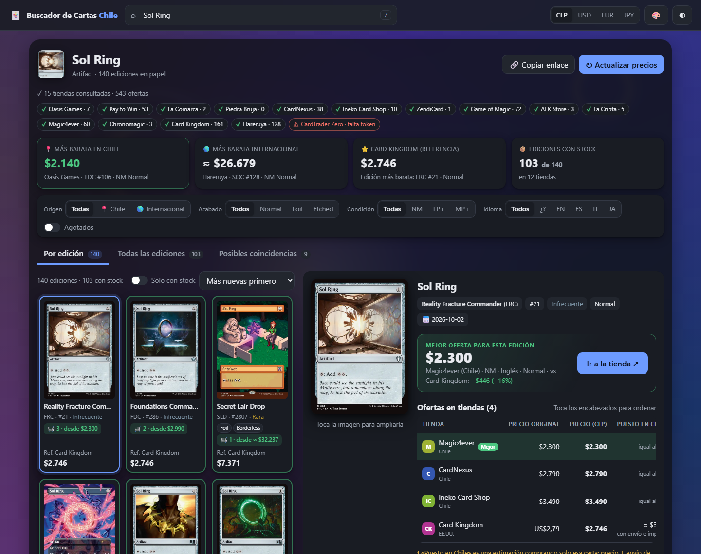
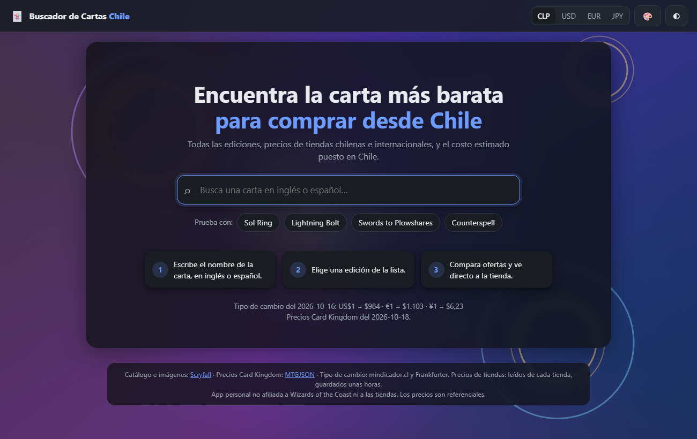
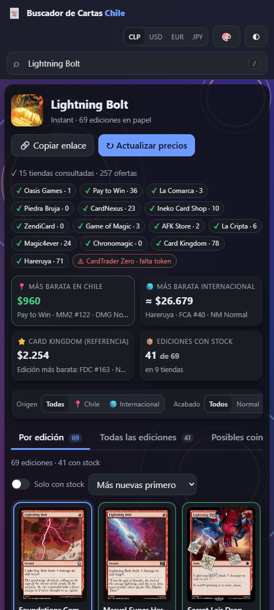

# 🃏 Buscador de Cartas Chile

Página web para buscar una carta de **Magic: The Gathering**, ver **todas sus ediciones** y
comparar sus precios en **tiendas chilenas e internacionales**, pensando en comprar desde Chile.

### 👉 Pruébala aquí: **https://buscador-cartas-chile.onrender.com**

> La primera visita puede tardar cerca de **1 minuto** en abrir: el servidor gratuito se "duerme"
> cuando nadie lo usa y tiene que despertar. Después funciona normal.



---

## ¿Qué hace?

- Busca cualquier carta de Magic **en inglés o en español** (con autocompletado).
- Muestra **todas sus ediciones** con imagen, código, número, rareza y variante (foil, borderless, showcase…).
- Compara precios en **16 tiendas chilenas** y **5 internacionales**, agrupadas en *Chile*, *Card Kingdom (referencia)*
  y *Tiendas extranjeras*, y dice cuál es la más barata.
- Muestra solo el **precio de la carta** (sin envío ni impuestos) en la moneda de la tienda, en **dólares** y en **pesos chilenos**,
  y la diferencia en % con **Card Kingdom** (verde si es más barato, rojo si es más caro).
- **Carrito:** junta cartas de varias tiendas y calcula, por tienda, subtotal, envío, IVA (solo compras extranjeras),
  arancel (si corresponde) y total, en dólares y en pesos.
- Si una tienda no se puede leer automáticamente, muestra el **enlace a su buscador** y deja **anotar el precio a mano**.
- Funciona en **PC y celular**, con modo oscuro y 15 fondos a elección.

## Cómo se usa (paso a paso)

1. Entra a **https://buscador-cartas-chile.onrender.com**.
2. Escribe el nombre de una carta, por ejemplo **Sol Ring** o **relámpago**, y elige una sugerencia.
3. Espera unos segundos: las tiendas van apareciendo a medida que responden (la barra de arriba muestra el avance).
4. Mira el **resumen**: la más barata en Chile, la más barata internacional y la referencia de Card Kingdom.
   Haz clic en cualquiera para ir a esa edición.
5. En la **grilla de ediciones**, las que tienen stock aparecen primero (borde verde). Haz clic en una.
6. A la derecha (o a pantalla completa en el celular) verás la **mejor oferta** y la tabla con todas las tiendas.
   El botón **«Ir a la tienda ↗»** te lleva directo al producto, y **«🛒+»** la agrega al carrito.
   Las tiendas que se revisan a mano tienen **«Buscar ↗»** y **«✎ Precio»** para anotar lo que veas.
7. Abre el **🛒 carrito** (arriba a la derecha): ahí ajustas el envío de cada tienda o marcas «Retiro en tienda».
8. Usa los **filtros** (Chile / internacional, foil, condición, idioma) y la pestaña **«Todas las ediciones»**
   para ver la oferta más barata de cada una.

| Inicio | En el celular |
|---|---|
|  |  |

## ¿Qué funciona hoy?

- ✅ Catálogo completo de Magic (Scryfall), con búsqueda en inglés y español.
- ✅ Precios de referencia: Card Kingdom (vía MTGJSON), TCGplayer y Cardmarket.
- ✅ Tiendas chilenas: Oasis Games, Pay to Win, La Comarca, Piedra Bruja, CardNexus, Ineko Card Shop,
  ZendiCard, Game of Magic, AFK Store, La Cripta, Magic4ever, Chronomagic, Card Souls, Rhystic Bazaar y Friki Cards.
- ✍️ Cat Lotus: solo a mano (su catálogo se carga desde una sección que su robots.txt prohíbe leer).
- ✅ Carrito con envío, IVA 19% y arancel 6% (si la compra en una tienda extranjera supera US$500).
  Las tiendas chilenas no suman IVA porque sus precios ya lo incluyen.
- ✅ Tiendas internacionales: Card Kingdom (EE.UU.), Hareruya (Japón) y TCGplayer (EE.UU., precio de mercado
  que entrega Scryfall; el precio real depende del vendedor).
- ✍️ Star City Games (EE.UU.): solo a mano, porque sus términos prohíben leer sus precios con programas.
- ✅ Emparejamiento automático de cada oferta con su edición exacta; lo dudoso se muestra aparte
  como «posible coincidencia» (nunca se asigna a una edición equivocada).

> ⚠️ **En la versión publicada en internet** algunas tiendas aparecen como «no disponible»:
> Oasis Games, Pay to Win, La Comarca, Piedra Bruja, Game of Magic, AFK Store e Ineko bloquean las
> consultas que vienen de servidores (datacenters), y la app respeta ese bloqueo. Card Souls usa la misma
> plataforma (Shopify), así que probablemente también.
> Magic4ever, Chronomagic y Friki Cards permiten ver su tienda solo para uso personal, así que en la versión
> pública se revisan a mano. En todos esos casos aparece el enlace a la tienda para anotar el precio.
> **Instalada en tu PC (ver más abajo) funcionan todas automáticamente** (menos Cat Lotus).

## ¿Qué falta por hacer?

- ⏳ **CardTrader Zero** (Italia): está programado, pero falta activar el token de la API.
- ⏳ **Pokémon TCG**: catálogo y tiendas.
- ⏳ **Búsqueda por foto** de la carta.
- ⏳ Más tiendas chilenas. Algunas no se pueden incluir porque sus reglas lo prohíben
  (la lista completa, con el motivo, está al final de la página).

## ¿Encontraste un error o tienes una idea?

- 🐞 **[Reportar un error](https://github.com/aggrojano-bit/buscador-cartas-chile/issues/new?template=reportar-error.yml)**
- 💡 **[Sugerir una mejora o una tienda nueva](https://github.com/aggrojano-bit/buscador-cartas-chile/issues/new?template=sugerir-mejora.yml)**

Solo necesitas una cuenta gratis de GitHub. También hay un botón **«🐞 Reportar un error»** en la esquina de la página.
Si sabes programar y quieres proponer cambios, lee [CONTRIBUTING.md](CONTRIBUTING.md).

---

## Instalar en tu PC (opcional)

Necesitas **Python 3.11 o más nuevo** (https://www.python.org, marcando «Add Python to PATH»).

1. Descarga el proyecto (botón verde **Code → Download ZIP**) y descomprímelo.
2. Haz doble clic en **`iniciar.bat`**. La primera vez tarda un par de minutos (instala lo necesario y
   descarga unos 40 MB de precios de Card Kingdom).
3. Abre **http://localhost:8001** en el navegador.
4. Desde el celular (mismo Wi-Fi), usa la dirección `http://192.168.x.x:8001` que aparece en la ventana negra.

**Ajustes:** envíos iniciales del carrito, impuestos, puerto, horas de caché y moneda inicial están en `ajustes.toml`.
**Datos privados:** copia `.env.example` como `.env` y pon ahí el token de CardTrader (ese archivo nunca se sube).

## Cómo funciona por dentro

```
app/            servidor (Python + FastAPI): catálogo, tipo de cambio, caché y emparejamiento
adaptadores/    una tienda por archivo, todas con la misma estructura
static/         la página (HTML, CSS y JavaScript, sin frameworks)
ajustes.toml    valores configurables
render.yaml     configuración para publicarla en Render.com
```

- **Tus datos:** el carrito y los precios anotados a mano se guardan solo en tu navegador.
- **Respeto a las tiendas:** se revisa el `robots.txt` y los términos de cada una; si prohíben la lectura
  automática, no se incluyen. Se usan pausas entre consultas (máximo 2 por segundo por tienda), un
  User-Agent identificable, y los resultados se guardan **6 horas** en caché.
- **Fuentes:** [Scryfall](https://scryfall.com) (catálogo e imágenes), [MTGJSON](https://mtgjson.com)
  (precios Card Kingdom), mindicador.cl y Frankfurter (tipo de cambio).

> Proyecto personal sin fines de lucro, no afiliado a Wizards of the Coast ni a las tiendas.
> Los precios son referenciales: confírmalos siempre en la tienda antes de comprar.
